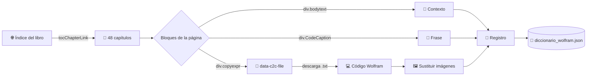

# 📚 Diccionario Wolfram: lenguaje natural → código

> Extractor que convierte el libro **[An Elementary Introduction to the Wolfram Language](https://www.wolfram.com/language/elementary-introduction/3rd-ed/)** (3.ª ed., Stephen Wolfram) en un diccionario estructurado de pares **frase en lenguaje natural ↔ código Wolfram Language**, listo para generar *embeddings* y alimentar sistemas de búsqueda semántica o RAG.


---

## 📑 Índice

- [✨ Qué hace](#-qué-hace)
- [⚙️ Cómo funciona](#️-cómo-funciona)
- [🚀 Instalación y uso](#-instalación-y-uso)
- [📦 Formato de salida](#-formato-de-salida)
- [📊 Resultados](#-resultados)
- [✅ Validación de calidad](#-validación-de-calidad)
- [🛠️ Configuración](#️-configuración)
- [⚠️ Limitaciones conocidas](#️-limitaciones-conocidas)
- [🗺️ Próximos pasos](#️-próximos-pasos)

---

## ✨ Qué hace

| | Funcionalidad |
|---|---|
| 🔎 | **Descubre los capítulos automáticamente** leyendo el índice del libro (48 capítulos). |
| 🧩 | **Extrae cada ejemplo de código** con su descripción y el párrafo explicativo que lo acompaña. |
| 💻 | **Recupera el código real**: en la web los ejemplos son imágenes; el programa descarga su versión en texto. |
| 🖼️ | **Sustituye imágenes incrustadas** (que pueden pesar varios MB) por marcadores legibles: `imagen`, `grafico`, `grafo`. |
| 🧹 | **Limpia el texto** eliminando espacios artificiales alrededor del código en línea. |
| 🔁 | **Detecta código duplicado** y lo enlaza con su primera aparición. |
| 🛡️ | **Tolera fallos de red** con reintentos automáticos y avisa de los capítulos que no pudo procesar. |
| 💾 | **Genera un JSON UTF-8** con un registro por ejemplo. |

---

## ⚙️ Cómo funciona



1. **Índice** — `obtener_capitulos()` descarga una página del libro y recoge los enlaces con clase `tocChapterLink`.
2. **Recorrido** — `extraer_capitulo()` lee los bloques del capítulo **en orden** para emparejar cada ejemplo con la frase y el párrafo que lo preceden.
3. **Código** — cada ejemplo apunta a un fichero de texto (`Files/…-io_N.txt.en`) con el código fuente exacto.
4. **Limpieza** — `reemplazar_cajas()` cambia las imágenes y gráficos incrustados (`\!\(\*GraphicsBox[…]\)`) por un símbolo.
5. **Post-proceso** — se marcan los duplicados y se guarda el resultado.

---

## 🚀 Instalación y uso

### 📋 Requisitos

- 🐍 Python 3.8 o superior
- 🌐 Conexión a Internet

```bash
pip install -r requirements.txt
```

### ▶️ Ejecución

| Comando | Descripción |
|---|---|
| `python creacion_diccionario.py` | 📚 Procesa **todo el libro** (48 capítulos) |
| `python creacion_diccionario.py --url <URL>` | 📄 Procesa **un único capítulo** |
| `python creacion_diccionario.py -o salida.json` | 💾 Cambia el fichero de salida |
| `python creacion_diccionario.py --pausa 1` | ⏱️ Segundos de espera entre capítulos (por defecto `0.5`) |

**Ejemplo de salida por consola:**

```text
[1/48]   3 ejemplos - https://www.wolfram.com/.../01-starting-out-elementary-arithmetic.html
[2/48]   7 ejemplos - https://www.wolfram.com/.../02-introducing-functions.html
...
[48/48]  11 ejemplos - https://www.wolfram.com/.../48-debugging-your-code.html
Guardados 919 registros en diccionario_wolfram.json
```

> ⏳ La ejecución completa tarda unos minutos (~48 páginas + ~900 descargas de código).

---

## 📦 Formato de salida

Cada elemento del JSON representa **un ejemplo de código**:

```json
{
  "intent_text": "Compute 3+4 using the function Plus",
  "context": "When you type 2+2, the Wolfram Language understands it as Plus[2, 2]. Plus is a function. ...",
  "embedding_text": "Compute 3+4 using the function Plus. When you type 2+2, the Wolfram Language ...",
  "metadata": {
    "example_code": "Plus[3, 4]",
    "embedded_objects": [],
    "chapter": "2 Introducing Functions",
    "source_url": "https://www.wolfram.com/language/elementary-introduction/3rd-ed/02-introducing-functions.html",
    "code_url": "https://www.wolfram.com/language/elementary-introduction/3rd-ed/Files/02-introducing-functions-io_1.txt.en",
    "duplicate_of": null
  }
}
```

| Campo | Descripción |
|---|---|
| 💬 `intent_text` | Frase que describe el ejemplo. Si no existe, se usa el contexto. |
| 📝 `context` | Párrafo explicativo previo (máx. 1000 caracteres, cortado sin partir palabras). |
| 🧠 `embedding_text` | **Texto recomendado para el embedding**: frase + contexto. |
| 💻 `metadata.example_code` | Código Wolfram Language del ejemplo. |
| 🖼️ `metadata.embedded_objects` | Marcadores sustituidos (`imagen`, `grafico`, `grafo`). |
| 📖 `metadata.chapter` | Número y título del capítulo. |
| 🌐 `metadata.source_url` | Página del capítulo. |
| 🔗 `metadata.code_url` | Fichero con el código **original** (incluye las imágenes completas). |
| 🔁 `metadata.duplicate_of` | Índice del primer registro con el mismo código, o `null`. |

**Ejemplo con imagen sustituida:**

```text
Blur[<3,5 MB de datos binarios>]   →   Blur[imagen]
ImageAdd[<imagen>, <imagen>]       →   ImageAdd[imagen, imagen]
CommunityGraphPlot[<grafo>]        →   CommunityGraphPlot[grafo]
```

---

## 📊 Resultados

| Métrica | Valor |
|---|---|
| 📚 Capítulos procesados | **48 / 48** |
| 🧾 Registros generados | **919** (coincide 1:1 con los ejemplos publicados) |
| 💾 Tamaño del JSON | **≈ 0,86 MB** (12,5 MB sin la sustitución de imágenes) |
| 📏 Longitud del código | mediana 41 caracteres · máximo 1.936 |
| 🖼️ Ejemplos con objetos sustituidos | 37 |
| 🔁 Códigos duplicados | 17 |
| 💬 Ejemplos sin frase propia | 22 |

---

## ✅ Validación de calidad

[`validar_diccionario.py`](validar_diccionario.py) comprueba que el JSON generado es correcto y coherente. No necesita dependencias extra para las comprobaciones locales.

```bash
python validar_diccionario.py               # comprobaciones locales
python validar_diccionario.py --online 25   # además compara 25 ejemplos al azar con la web
python validar_diccionario.py -f otro.json  # valida otro fichero
```

> 🚦 Termina con código `0` si no hay errores y `1` si los hay (los avisos no cambian el código), por lo que se puede usar en automatizaciones.

### 🔍 Qué comprueba

| | Comprobación | Tipo |
|---|---|---|
| 🧱 | **Estructura**: todos los campos existen y no están vacíos; las URL tienen la forma esperada | ❌ Error |
| 🔗 | **Coherencia**: `embedding_text` contiene `intent_text`; `duplicate_of` apunta a un código idéntico; no hay repetidos sin marcar; los marcadores `imagen`/`grafico`/`grafo` aparecen en el código | ❌ Error |
| 🖼️ | **Cajas incrustadas** sin sustituir en el código | ❌ Error |
| 📚 | **Cobertura**: hay 48 capítulos | ❌ Error |
| 🌐 | **Contra la web** (`--online`): el código guardado coincide con el original | ❌ Error |
| 🧮 | **Sintaxis**: corchetes, llaves y paréntesis balanceados (ignorando cadenas y comentarios) | ⚠️ Aviso |
| 📏 | Código muy largo, `CompressedData` suelto o caracteres privados (iconos) en el texto | ⚠️ Aviso |
| 🧹 | Espaciado raro en el contexto (¿icono perdido?) | ⚠️ Aviso |
| 💬 | Ejemplos **sin frase propia** (`intent_text` = `context`) | ⚠️ Aviso |

### 📋 Resultado con el diccionario actual

```text
❌ 2 error(es)
  ERROR  #413: queda una caja incrustada sin sustituir
  ERROR  #415: queda una caja incrustada sin sustituir

⚠️  38 aviso(s) en 3 tipo(s)
    22 × sin frase propia
    15 × espaciado raro en el contexto
     1 × contiene CompressedData sin sustituir
```

- ❌ Los **2 errores** son conocidos: dos ejemplos del capítulo 26 con varios círculos de colores pequeños que se conservan tal cual (solo se sustituyen los objetos de más de `MAX_CAJA` caracteres).
- ⚠️ Los **avisos** son limitaciones documentadas del contenido de origen, no fallos del proceso.
- 🌐 Las muestras comparadas con la web **coinciden** con el código original.

> 💡 Ejecuta el validador cada vez que regeneres el JSON para detectar regresiones.

---

## 🛠️ Configuración

Constantes ajustables al inicio de [`creacion_diccionario.py`](creacion_diccionario.py):

| Constante | Valor | Uso |
|---|---|---|
| `BASE_URL` | `…/elementary-introduction/3rd-ed/` | Raíz del libro |
| `URL_TEST` | capítulo 2 | Página de la que se lee el índice |
| `TIMEOUT` | `30` s | Tiempo máximo por petición |
| `REINTENTOS` | `4` | Intentos por descarga (espera 2 s, 4 s, 8 s…) |
| `MAX_CONTEXTO` | `1000` | Longitud máxima del contexto |
| `MAX_CAJA` | `300` | Objetos incrustados más cortos se conservan tal cual |

---

## ⚠️ Limitaciones conocidas

- 📄 **Páginas no incluidas**: solo se leen los 48 capítulos. Quedan fuera *What We Haven't Discussed* (35 ejemplos) y *Answers to Exercises* (671 soluciones).
- 🧷 **Dependencia del HTML**: el programa se basa en clases como `tocChapterLink`, `bodytext`, `CodeCaption` y `copyexpr`. Si Wolfram cambia su web, habrá que adaptarlo.
- 🔣 **Iconos en el texto**: en unos pocos contextos se pierde un icono gráfico (p. ej. *"entities are indicated by ."*).
- 📈 **Sin resultados**: no se guarda la salida (`Out[]`) de cada ejemplo, que se publica como imagen.
- 📦 **Datos comprimidos sueltos**: un ejemplo conserva un `CompressedData[…]` que no es una imagen.

---

## 🗺️ Próximos pasos

- [ ] ➕ Incluir *What We Haven't Discussed* y las **soluciones de los ejercicios** (enunciado → código).
- [ ] 🧠 Generar los *embeddings* de `embedding_text`.
- [ ] 🔍 Montar un buscador semántico: *"¿cómo desenfoco una imagen?"* → `Blur[imagen]`.
- [ ] 🧪 Validar los ejemplos ejecutándolos en Mathematica / Wolfram Engine.

---

## 📄 Licencia y créditos

- 💻 Código bajo licencia **MIT** — ver [`LICENSE`](../LICENSE).
- 📖 El contenido extraído pertenece a **© Stephen Wolfram, LLC**. Úsalo respetando sus [términos de uso](https://www.wolfram.com/legal/).
